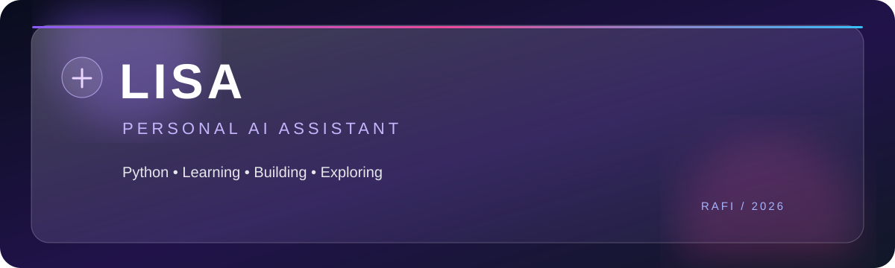

<div align="center">



### Your personal AI assistant, built step by step with Python.

[](https://www.python.org/)
[](#-project-status)
[](https://github.com/sheikhrafi20)

</div>

---

## ✨ About LISA

**LISA** is a personal AI assistant project by **RAFI**, built with Python. It is developed gradually, starting with a clean foundation and adding useful assistant capabilities in small, testable stages.

The current version (**V3**) is a command-line assistant that understands simple **বাংলা + English** messages and has basic internet utilities.

## 🚀 Features (V3)

- 🗣️ Bilingual (বাংলা + English) replies to common messages
- 🌐 Internet connection check
- 🔎 Web search from the terminal (returns links, not AI-generated answers)
- 🕒 Local time
- 💾 Local chat history, saved on your own computer only
- 📜 `history` command to view recent messages

> ⚠️ This version does **not** include an AI language model yet. Replies are rule-based.

## ⚡ Quick start

```bash
git clone https://github.com/sheikhrafi20/LISA-AI.git
cd LISA-AI
python -m src.main
```

Run it from the project root. If `requirements.txt` lists any packages, install them first with `pip install -r requirements.txt`.

## 💬 Commands

| Command | What it does |
|---|---|
| `help` | Show all commands |
| `about` | About LISA |
| `time` | Show local time |
| `internet` | Check internet connection |
| `search <query>` | Search the public web |
| `history` | Show recent chat history |
| `clear` | Clear the terminal |
| `exit` | Close LISA |

## 🧰 Technology

| Technology | Purpose |
|---|---|
| Python | Main programming language |
| Git & GitHub | Version control and project hosting |

## 📁 Project structure

```text
LISA-AI/
├── assets/
│   └── lisa-banner.svg
├── src/
│   ├── main.py        # CLI, commands and chat loop
│   └── network.py     # Internet check and web search
├── .gitignore
├── README.md
└── requirements.txt
```

## 🎯 Project goals

- Build a solid Python-based assistant foundation
- Create a simple, user-friendly interface
- Explore conversational AI features
- Add features in small, testable stages
- Keep user permissions and privacy in mind

## 🔒 Privacy

Chat history is stored locally in `data/chat_history.json`, which is excluded from Git via `.gitignore`. Web search sends only the query you type.

## 🚧 Project status

LISA is in **active early development**. Planned next steps include adding an AI model, improving conversation, and adding tests.

## 👨‍💻 Developer

**RAFI** — [@sheikhrafi20](https://github.com/sheikhrafi20)

---

<div align="center">

*Built with curiosity, Python, and consistent learning.*

</div>
